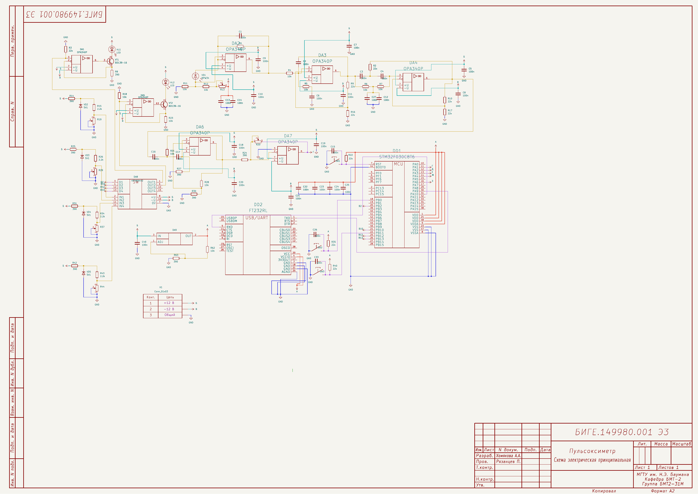
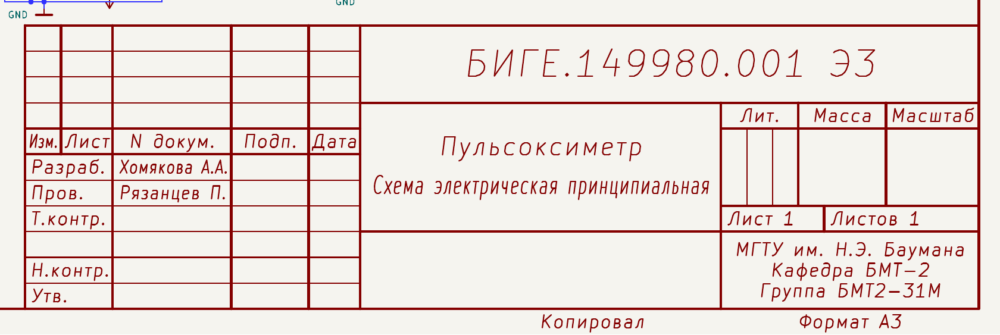
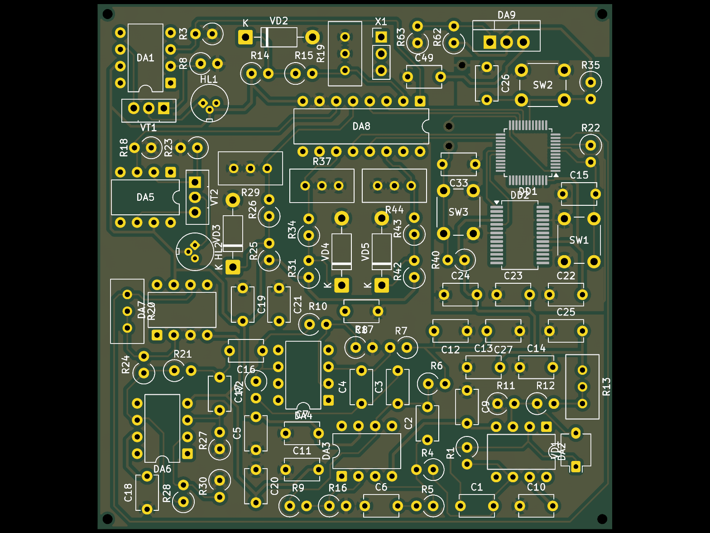
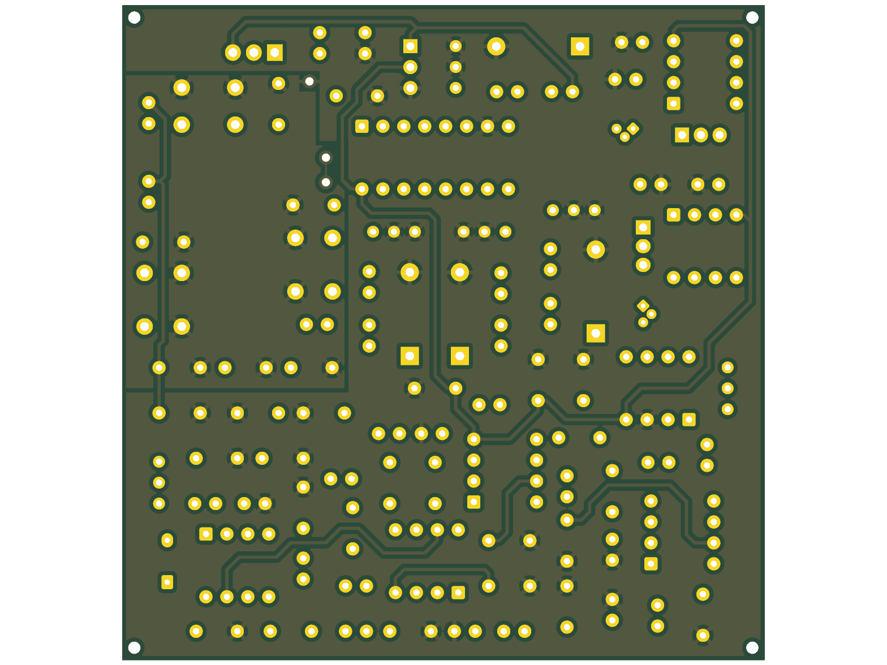
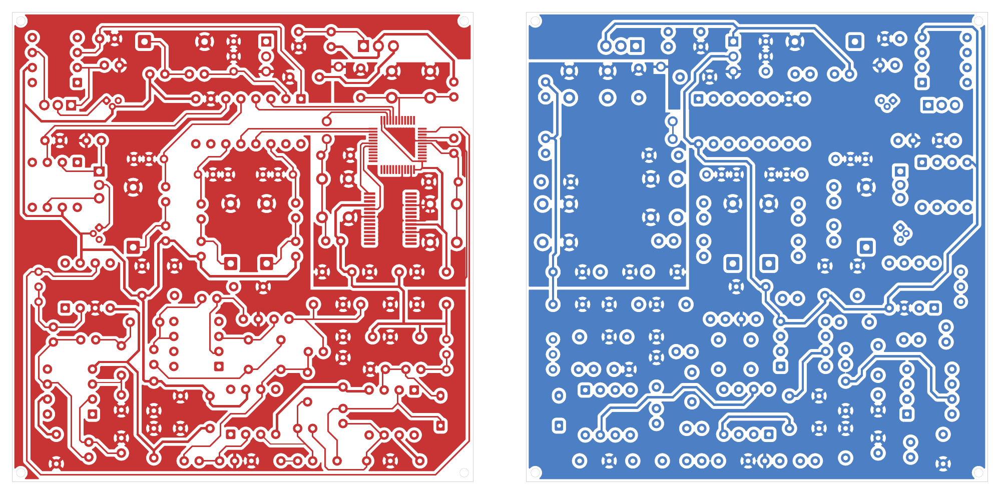
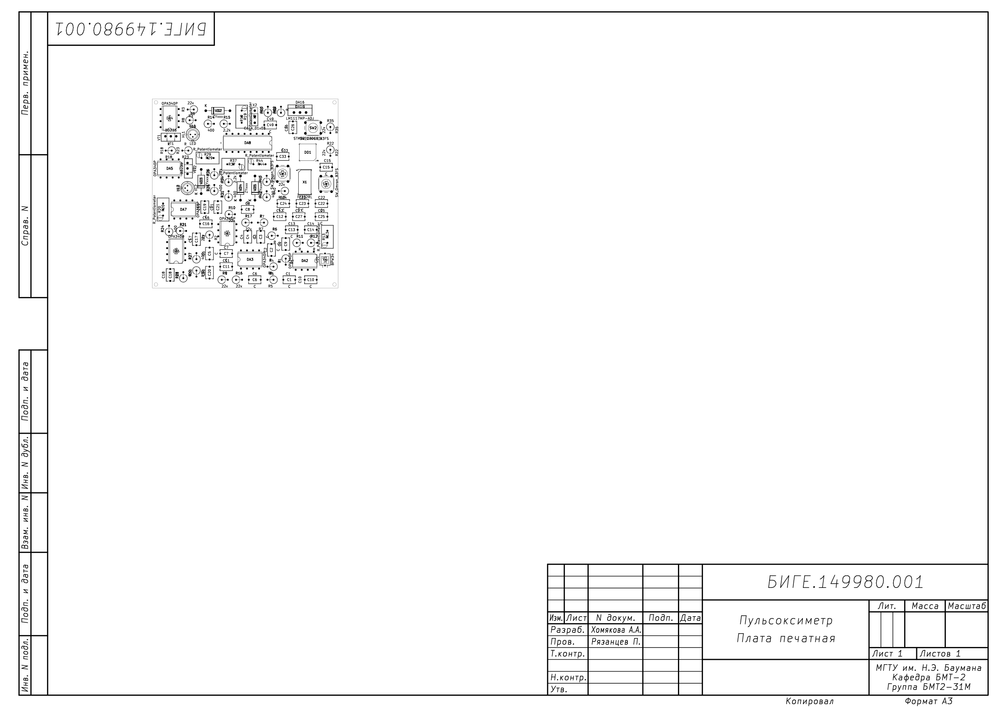

<div class="title-page" align="center">

<table class="title-head"><tr>
<td></td>
<td align="center">
<b>Министерство науки и высшего образования Российской Федерации</b><br>
<b>Федеральное государственное автономное образовательное учреждение высшего образования</b><br>
<b>«Московский государственный технический университет имени Н.Э. Баумана<br>
(национальный исследовательский университет)»</b><br>
<b>(МГТУ им. Н.Э. Баумана)</b>
</td></tr></table>

<p class="tp-line">ФАКУЛЬТЕТ <u>БИОМЕДИЦИНСКАЯ ТЕХНИКА</u></p>
<p class="tp-line">КАФЕДРА <u>МЕДИКО-ТЕХНИЧЕСКИЕ ИНФОРМАЦИОННЫЕ ТЕХНОЛОГИИ (БМТ-2)</u></p>

<p class="tp-title">Домашнее задание</p>
<p class="tp-sub">по курсу «САПР электронных средств»</p>
<p class="tp-topic">«Проект печатного узла пульсоксиметра в KiCad:<br>оформление по ГОСТ, библиотека компонентов, автоматизация проверки и выпуска»</p>
<p class="tp-sub">Обозначение документа: БИГЕ.149980.001 Э3</p>

<table class="tp-sign">
<tr><td>Группа</td><td><u>БМТ2-31М</u></td><td></td></tr>
<tr><td>Студент</td><td>_________________</td><td><u>Хомякова А.А.</u></td></tr>
<tr><td></td><td class="hint">подпись, дата</td><td class="hint">фамилия, и.о.</td></tr>
<tr><td>Преподаватель</td><td>_________________</td><td><u>Рязанцев П.</u></td></tr>
<tr><td></td><td class="hint">подпись, дата</td><td class="hint">фамилия, и.о.</td></tr>
</table>

<p class="tp-city">Москва, 2026 г.</p>
</div>

<div class="page-break"></div>

## Содержание

- [Задание](#задание)
- [1. Библиотека компонентов (УГО + посадочные места)](#1-библиотека-компонентов-уго--посадочные-места)
- [2. Схема электрическая принципиальная](#2-схема-электрическая-принципиальная)
- [3. Файл печатной платы](#3-файл-печатной-платы)
- [4. Скрипт проверки и выпуска (bash / bat)](#4-скрипт-проверки-и-выпуска-bash--bat)
- [5. Git-репозиторий и GitHub](#5-git-репозиторий-и-github)
- [Заключение: выполнение пунктов задания](#заключение-выполнение-пунктов-задания)

## Задание

Общее задание: создать проект печатной платы в KiCad. Проект должен содержать:

1. **Библиотеку компонентов** (УГО + посадочные места). УГО компонентов оформить по ГОСТ.
   Библиотека должна подключаться к проекту как git-сабмодуль. Пути библиотек должны быть
   относительными.
2. **Схему электрическую принципиальную**, оформленную по ГОСТ (как минимум рамка и основная
   надпись). Все «важные» цепи (шины питания, основные сигнальные цепи) описаны в классах цепей
   (допустимо цветовое обозначение). В полях компонентов завести `Manufacturer_Part_Number` с
   реальным партномером компонента.
3. **Файл печатной платы.** При трассировке учитывать технологические возможности завода «Резонит»,
   соблюдать технологичность платы (DFMA-подход).
4. **Скрипт bash** (для Windows — файл `.bat`): проверка ERC, DRC, генерация Gerber-файлов,
   BOM (перечень элементов), PDF-версии схемы.

Проект размещается в git-репозитории на персональной странице GitHub. Отчёт — PDF-версия файла
`README.md` (этот документ). Разделы 1–4 отчёта соответствуют пунктам задания 1–4, раздел 5 —
требованию о git-репозитории и GitHub.

Объект проектирования — **пульсоксиметр**: двухканальный оптический датчик (два светодиода и
фотодиод), аналоговый тракт на ОУ, микроконтроллер STM32F030 и преобразователь USB–UART.
Работа выполнена в KiCad 10.0.

## 1. Библиотека компонентов (УГО + посадочные места)

### 1.1. Состав библиотеки

Библиотека — отдельный git-репозиторий `kicad-gost-lib`, подключённый к проекту сабмодулем.

```
kicad-gost-lib/
├── symbols/GOST_UGO.kicad_sym          УГО компонентов по ГОСТ (21 шт.)
├── footprints/GOST_FP.pretty/          посадочные места (19 шт.)
├── drawing_sheets/GOST_form1.kicad_wks рамка листа и основная надпись, ГОСТ 2.104, форма 1
├── tools/gen_gost_lib.py               генератор УГО (символы описаны кодом)
├── tools/gen_wks.py                    генератор рамки
└── docs/                               изображения
```

### 1.2. УГО по ГОСТ

Все компоненты схемы проверены на соответствие таблицам ГОСТ 2.721, 2.728, 2.730, 2.743, 2.755, 2.759
(таблица 1). Штатные символы KiCad выполнены по ANSI/IEC; там, где форма отличается от ЕСКД, нарисованы
собственные УГО, и вся схема переведена на библиотеку GOST_UGO (рисунок 1, таблица 2).

<p class="caption tcap">Таблица 1 — Проверка УГО схемы на соответствие ГОСТ</p>

| Компоненты | Было (KiCad) | Соответствие ГОСТ | Что сделано |
|---|---|---|---|
| DA1–DA7 (ОУ) | `Amplifier_Operational` — треугольник | нет: ГОСТ 2.759 требует прямоугольник с «▷∞» | `GOST_UGO:OPA340P` |
| DA8, DA9, DD1, DD2 | прямоугольник без полей | нет: ГОСТ 2.743 — основное и дополнительные поля | `KR590KN2`, `LM1117MP-ADJ`, `STM32F030C8Tx`, `FT232RL` |
| X1 | `Conn_01x03` — колодка | нет: ГОСТ 2.755 — табличная форма | `Conn_1x03` |
| SW1–SW3 | `SW_Omron_B3FS` | нет: ГОСТ 2.755 — замыкающий контакт 30°, нажимной привод | `SW_Push_NO` |
| GND (36 шт.) | `power:GND` — треугольник | нет: ГОСТ 2.721 табл. 6б п. 4 — «⊥» | `GND` |
| R13, R19, R20, R29, R37, R44 | `R_Potentiometer` — стрелка (переменный) | нет: подстроечный по ГОСТ 2.728 — отрезок с «Т» | `R_Trim` |
| C1–C49 | `Device:C`, зазор между пластинами = 3/8 длины | нет: ГОСТ 2.728 — пластины 8 мм, зазор 1,5 мм | `C` |
| HL1, HL2 | `Device:LED`, корпус Ø5,7, треугольник 53° | частично: ГОСТ 2.730 — корпус Ø10 (1:2 → Ø5), 60° | `LED` |
| VD1 | `BPW34` | частично: ГОСТ 2.730 — фотодиод в корпусе, стрелки внутрь 45° | `Photodiode` |
| VT1, VT2 | `BD235`, угол К–Э 90° | нет: ГОСТ 2.730 — корпус Ø12, угол К–Э 60° | `Q_NPN` |
| VD2–VD5 | `ZYxxx` | да по форме (черта с одним отгибом), треугольник 53° | `D_Zener` (60°) |
| R (34 шт.) | `Device:R` 5,08 × 2,03 | да (10 × 4 в масштабе 1:2) | `R` — для единообразия библиотеки |
| Шины питания «Б», «В», «А» (31 шт.) | `power:+12V`, `power:+3.3V` | форма допустима (стрелка с наименованием цепи), но символ из штатной библиотеки | `PWR` — та же форма, имя цепи = значение |
| PWR_FLAG (3 шт.) | `power:PWR_FLAG` | служебный символ ERC, на печать не выводится | `PWR_FLAG` |

Дискретные элементы выполнены в масштабе 1:2 к размерам из таблиц ГОСТ: так они ложатся на сетку
KiCad 2,54 мм, и все УГО на листе уменьшены одинаково. Выводы новых символов стоят в тех же точках и
с теми же номерами, что у штатных, поэтому символы заменены без изменения проводов. После замены
проверено, что список связей схемы (`kicad-cli sch export netlist`) не изменился. В итоговой схеме
все 93 компонента и все символы питания взяты из библиотеки `GOST_UGO` — штатных символов KiCad не
осталось.

Символы описаны кодом
(`tools/gen_gost_lib.py`), поэтому размеры, шаг выводов и шрифты задаются в одном месте и
одинаковы во всех символах.


<p class="caption">Рисунок 1 — УГО библиотеки GOST_UGO</p>

<p class="caption tcap">Таблица 2 — УГО библиотеки</p>

| Символ | Поз. обозн. | Стандарт | Особенности |
|---|---|---|---|
| `OPA340P` | DA | ГОСТ 2.759, 2.743 | основное поле со знаком «▷∞», инвертирующий вход — указатель инверсии, питание отдельной группой |
| `KR590KN2` | DA | ГОСТ 2.743 | функция «SW», группы: управление D1–D4, входы, выходы, питание |
| `LM1117MP-ADJ` | DA | ГОСТ 2.743 | вход и ADJ слева, выход справа |
| `STM32F030C8Tx` | DD | ГОСТ 2.743 | функция «MCU», выводы сгруппированы по портам, питание отдельной группой |
| `FT232RL` | DD | ГОСТ 2.743 | функция «USB/UART», выводы с активным низким уровнем — кружком |
| `Conn_1x02…1x06` | X | ГОСТ 2.755 | таблица «Конт. / Цепь», наименования цепей — поля экземпляра `Цепь1…ЦепьN` |
| `SW_Push_NO` | SB | ГОСТ 2.755, 2.721 | замыкающий контакт, нажимной привод, механическая связь |
| `GND` | — | ГОСТ 2.721 | «электрическое соединение с корпусом (общий провод)», «⊥» |
| `PWR` | — | ГОСТ 2.702 | шина питания: стрелка с наименованием цепи («Б», «В», «А»); имя цепи — значение символа |
| `PWR_FLAG` | — | — | служебный флаг источника питания для ERC, в документ не выводится |
| `R`, `R_Trim` | R | ГОСТ 2.728 | 10 × 4 (1:2); подстроечный — отрезок с «Т» |
| `C` | C | ГОСТ 2.728 | пластины 8, зазор 1,5 (1:2) |
| `LED`, `Photodiode` | HL, VD | ГОСТ 2.730 | корпус Ø10 (1:2), треугольник 60°, стрелки 45° наружу / внутрь |
| `D_Zener` | VD | ГОСТ 2.730 | черта катода с одним отгибом |
| `Q_NPN` | VT | ГОСТ 2.730 | корпус Ø12 (1:2), угол коллектор–эмиттер 60°, стрелка эмиттера |

Общие правила: у ИМС основное и дополнительные поля, группы выводов разделены линией и пустым шагом,
корпус без заливки, толщина линий УГО равна толщине линий связи, шаг выводов 2,54 мм. В каждом
символе заполнены поля `Footprint` (ссылка на `GOST_FP`), `Datasheet`, `Manufacturer`,
`Manufacturer_Part_Number`.

### 1.3. Посадочные места

Все посадочные места проекта (19 шт.) перенесены в библиотеку `GOST_FP.pretty` (таблица 3). Основа —
официальная библиотека KiCad (IPC-7351). Посадочные места хранятся вместе с проектом, поэтому плата
не меняется при обновлении библиотек, установленных вместе с KiCad. В схеме и на плате все
компоненты ссылаются на `GOST_FP:…`.

<p class="caption tcap">Таблица 3 — Посадочные места библиотеки GOST_FP</p>

| Посадочное место | Компоненты |
|---|---|
| `R_Axial_DIN0309_L9.0mm_D3.2mm_P2.54mm_Vertical` | резисторы R1–R63 |
| `Potentiometer_Bourns_3296W_Vertical` | подстроечные R13, R19, R20, R29, R37, R44 |
| `C_Disc_D5.1mm_W3.2mm_P5.00mm` | конденсаторы C1–C49 |
| `DIP-8_W7.62mm`, `DIP-16_W7.62mm` | DA1–DA7 (OPA340), DA8 (КР590КН2) |
| `LQFP-48_7x7mm_P0.5mm`, `SSOP-28_5.3x10.2mm_P0.65mm` | DD1 (STM32), DD2 (FT232RL) |
| `TO-220-3_Vertical` (и запасной `SOT-223-3_TabPin2`) | DA9 (LM1117T-ADJ) |
| `TO-126-3_Vertical` | VT1, VT2 |
| `D_DO-41_SOD81_P10.16mm_Horizontal` | стабилитроны VD2–VD5 |
| `Osram_DIL2_4.3x4.65mm_P5.08mm` | фотодиод VD1 (BPW34) |
| `LaserDiode_TO18-D5.6-3` | светодиоды HL1, HL2 |
| `SW_PUSH_6mm` | кнопки SW1–SW3 |
| `PinHeader_1x02…1x06_P2.54mm_Vertical` | соединитель X1 (и запасные варианты) |

### 1.4. Подключение библиотеки как git-сабмодуля

```bash
cd pulse-oximeter
git submodule add ../kicad-gost-lib.git lib/kicad-gost-lib
git commit -m "Библиотека kicad-gost-lib подключена сабмодулем"
```

Файл `.gitmodules`:

```
[submodule "lib/kicad-gost-lib"]
    path = lib/kicad-gost-lib
    url = ../kicad-gost-lib.git
```

Адрес сабмодуля **относительный**: он отсчитывается от адреса основного репозитория. Если оба
репозитория лежат в одном аккаунте GitHub, адрес сам превращается в
`https://github.com/<логин>/kicad-gost-lib.git`, и при переносе или форке ничего менять не нужно.
Проект зафиксирован на конкретной версии (коммите) библиотеки. Обновить библиотеку:

```bash
git submodule update --remote lib/kicad-gost-lib
git commit -am "Обновлена библиотека kicad-gost-lib"
```

### 1.5. Относительные пути

Все пути к библиотекам и рамке заданы через `${KIPRJMOD}` — папку проекта. Абсолютных путей в
файлах проекта нет.

`sym-lib-table`:

```
(lib (name "GOST_UGO")(type "KiCad")
     (uri "${KIPRJMOD}/lib/kicad-gost-lib/symbols/GOST_UGO.kicad_sym")(options "")(descr "УГО по ЕСКД"))
```

`fp-lib-table`:

```
(lib (name "GOST_FP")(type "KiCad")
     (uri "${KIPRJMOD}/lib/kicad-gost-lib/footprints/GOST_FP.pretty")(options "")(descr "Посадочные места"))
```

Рамка (схема и плата): `${KIPRJMOD}/lib/kicad-gost-lib/drawing_sheets/GOST_form1.kicad_wks`.
3D-модели — из штатной библиотеки KiCad через переменную `${KICAD10_3DMODEL_DIR}`.

## 2. Схема электрическая принципиальная

### 2.1. Схема и функциональные узлы

Схема приведена на рисунке 2, функциональные узлы — в таблице 4.

<p class="caption tcap">Таблица 4 — Функциональные узлы схемы</p>

| Узел | Элементы | Назначение |
|---|---|---|
| Ввод питания | X1 | ±12 В и общий провод (цепи «Б», «В», GND) |
| Стабилизатор | DA9 (LM1117-ADJ), R62, R63, C49 | питание цифровой части (цепь «А») |
| Источники опорного напряжения | VD2–VD5, R14, R25, R31, R42, R15, R26, R34, R43, R19, R29, R37, R44 | четыре регулируемых опорных уровня |
| Коммутатор | DA8 (КР590КН2) | выбор опорного уровня сигналами МК (цепи `SW_D1`…`SW_D4`) |
| Стабилизаторы тока светодиодов | DA1, VT1, R8 — HL1; DA5, VT2, R23 — HL2 | ток излучателей задаётся опорным напряжением |
| Фотоприёмник | VD1 (BPW34), DA2 | преобразование тока фотодиода в напряжение |
| Фильтрация и усиление | DA3, DA4, DA6, DA7 с RC-цепями | выделение пульсовой составляющей, усиление до уровня АЦП |
| Микроконтроллер | DD1 (STM32F030C8T6), SW1–SW3, C21–C25 | АЦП, управление коммутатором, кнопки, сброс |
| Интерфейс USB–UART | DD2 (FT232RL) | связь с компьютером (UART МК — PA9/PA10) |

<div class="landscape">



<p class="caption">Рисунок 2 — Схема электрическая принципиальная БИГЕ.149980.001 Э3 (лист A3, цвет линий — класс цепи)</p>

</div>

### 2.2. Оформление по ГОСТ: рамка и основная надпись

Рамка `GOST_form1.kicad_wks` из библиотеки (генератор `tools/gen_wks.py`): поле подшивки 20 мм,
остальные поля 5 мм, основная надпись по **форме 1** ГОСТ 2.104 (185 × 55 мм), дополнительные
графы 19–26, надписи «Копировал» и «Формат». Графы заполняются в *Файл → Параметры страницы*
(таблица 5). Значения хранятся в файлах схемы и платы, формат листа подставляется автоматически
(`${PAPER}`). Схема выполнена на листе **A3**, чертёж платы — на листе **A4**.

<p class="caption tcap">Таблица 5 — Заполнение основной надписи</p>

| Графа ГОСТ 2.104 | Поле KiCad | Схема | Плата |
|---|---|---|---|
| 2, 26 — обозначение документа | Comment 1 | БИГЕ.149980.001 Э3 | БИГЕ.149980.001 |
| 1 — наименование изделия | Title | Пульсоксиметр | Пульсоксиметр |
| 1 — наименование документа | Comment 2 | Схема электрическая принципиальная | Плата печатная |
| Разраб. | Comment 3 | Хомякова А.А. | Хомякова А.А. |
| Пров. | Comment 4 | Рязанцев П. | Рязанцев П. |
| Т.контр., Н.контр., Утв. | Comment 5–7 | — | — |
| 9 — организация | Company, Comment 8, 9 | МГТУ им. Н.Э. Баумана, Кафедра БМТ-2, Группа БМТ2-31М | то же |
| Лист / Листов, Формат | `${#}`, `${##}`, `${PAPER}` | 1 / 1, A3 | 1 / 1, A4 |



<p class="caption">Рисунок 3 — Основная надпись схемы (форма 1 ГОСТ 2.104)</p>

### 2.3. Классы цепей

Классы заданы в *Файл → Параметры схемы → Проект → Классы цепей* и хранятся в
`pulse_oximeter.kicad_pro` (таблица 6). Цепи назначаются классам по **шаблонам имён** (раздел
*Назначения классов цепей* в том же окне), поэтому классы автоматически применяются и к новым цепям.
Цвет класса — цвет линий связи на схеме (рисунок 2), ширина — ширина проводника, которую
трассировщик платы подставляет по умолчанию.

<p class="caption tcap">Таблица 6 — Классы цепей</p>

| Класс | Цепи (шаблоны имён) | Цвет на схеме | Проводник, мм |
|---|---|---|---|
| Power_12V | шины питания `Б` (+12 В), `В` (−12 В) | бирюзовый | 0,5 |
| Power_3V3 | шина питания `А` (выход DA9) | красный | 0,4 |
| GND | `GND` (общий провод) | синий | 0,5 |
| Analog | основные сигнальные цепи аналогового тракта: `*PD_*`, `*TIA*`, `*LPF*`, `*NOTCH*`, `*HPF*`, `*ADC*`, `*REF*`, `*LED*`; прочие цепи тракта `Net-(DA*`, `Net-(VD*`, `Net-(HL*`, `Net-(VT*`, `Net-(R*`, `Net-(C*` | жёлтый | 0,25 |
| Digital | `*SW_D*` (управление коммутатором), `*UART*`, `*NRST*`, `*BTN*`, `Net-(DD*` | фиолетовый | 0,25 |
| Default | прочие | — | 0,2 |

Шины питания и общий провод обозначены символами `PWR` и `GND` из библиотеки, имя цепи — значение
символа (`Б`, `В`, `А`, `GND`). Основные сигнальные цепи обозначены **метками** (*Разместить → Метка*,
клавиша **L**) — таблица 7. Имя локальной метки KiCad хранит с префиксом листа (`/TIA_OUT`), поэтому
шаблоны записаны со звёздочкой: `*TIA*` совпадает и с `TIA_OUT`, и с `/TIA_OUT`. Сигнальные цепи,
которые в исходной схеме были оформлены символами питания (`Г`, `В2`, `В10`, `В12`, `В13`), переведены
на метки: символ питания годится только для шин питания.

<p class="caption tcap">Таблица 7 — Метки основных цепей</p>

| Метка | Где стоит | Что за цепь | Класс |
|---|---|---|---|
| `PD_K` | VD1, вывод 1 (катод) | фотодиод → инвертирующий вход DA2 | Analog |
| `PD_A` | VD1, вывод 2 (анод) | смещение фотодиода (R11, R12, R13) | Analog |
| `TIA_OUT` | DA2, вывод 6 | выход трансимпедансного усилителя | Analog |
| `LPF_OUT` | DA3, вывод 6 | выход ФНЧ | Analog |
| `NOTCH_OUT` | DA4, вывод 6 | выход режекторного фильтра (двойной Т-мост C3, C4, R6, R7) | Analog |
| `HPF_OUT` | DA6, вывод 6 | выход ФВЧ | Analog |
| `ADC_IN` | DA7, вывод 6 и DD1, вывод 11 (PA1) | сигнал на АЦП МК | Analog |
| `REF1`…`REF4` | DA8, выводы 2, 5, 11, 14 (IN1…IN4) | опорные напряжения со стабилитронов | Analog |
| `LED1_REF`, `LED2_REF` | DA8, выводы 1, 6 (OUT1, OUT2) | задание тока светодиодов HL1, HL2 | Analog |
| `SW_D1`…`SW_D4` | DA8, выводы 3, 4, 12, 13 и DD1, выводы 20, 21, 25, 26 | управление коммутатором | Digital |
| `UART_TX`, `UART_RX` | DD1, выводы 30 (PA9), 31 (PA10) | UART МК ↔ DD2 | Digital |
| `NRST` | DD1, вывод 7 | сброс, кнопка SW1 | Digital |
| `BTN1`, `BTN2` | DD1, выводы 18 (PB0), 22 (PB11) | кнопки SW2, SW3 | Digital |

По списку цепей (`kicad-cli sch export netlist`) проверено, что каждая цепь схемы попадает в класс:
Analog — 35, Digital — 9, Power_12V — 2, Power_3V3 — 1, GND — 1. В класс Default попадают только
74 одиночных неиспользуемых вывода, отмеченных флагом «не подключено» (`unconnected-…`).

### 2.4. Поле Manufacturer_Part_Number

У всех компонентов заполнены поля `Manufacturer` и `Manufacturer_Part_Number`. Поля
редактировались в *Инструменты → Массовое редактирование полей символов* с группировкой по номиналу
и посадочному месту: партномер вписывается один раз на группу одинаковых компонентов. Партномера
сверены по каталогам поставщиков (LCSC, RS, Element14, Future Electronics). Перечень элементов
(таблица 8) формирует скрипт (раздел 4).

<p class="caption tcap">Таблица 8 — Перечень элементов (output/pulse_oximeter_BOM.csv)</p>

| Поз. обозначение | Номинал / тип | Кол. | Производитель | Manufacturer_Part_Number |
|---|---|---|---|---|
| C1–C27, C33, C49 | 100 нФ, X7R, 50 В | 29 | Murata | RDER71H104K0P1H03B |
| DA1–DA7 | OPA340P | 7 | Texas Instruments | OPA340PA |
| DA8 | КР590КН2 | 1 | — | КР590КН2 |
| DA9 | LM1117T-ADJ (TO-220) | 1 | Texas Instruments | LM1117T-ADJ/NOPB |
| DD1 | STM32F030C8T6 | 1 | STMicroelectronics | STM32F030C8T6 |
| DD2 | FT232RL | 1 | FTDI | FT232RL-REEL |
| HL1, HL2 | светодиод | 2 | Vishay | TSAL6200 |
| R1, R4–R7, R11, R12, R18, R21, R23, R28, R62 | 10 кОм, 0,5 Вт, 1 % | 12 | YAGEO | MFR50SFTE52-10K |
| R2, R3, R9, R10, R16, R17, R22, R35, R40 | 22 кОм, 0,5 Вт, 1 % | 9 | YAGEO | MFR50SFTE52-22K |
| R8, R14, R24, R25, R27, R30, R31, R42, R63 | 390 Ом, 0,5 Вт, 1 % | 9 | YAGEO | MFR50SFTE52-390R |
| R13, R19, R20, R29, R37, R44 | 10 кОм, подстроечный | 6 | Bourns | 3296W-1-103LF |
| R15, R26, R34, R43 | 2,2 кОм, 0,5 Вт, 1 % | 4 | YAGEO | MFR50SFTE52-2K2 |
| SW1–SW3 | кнопка 6 × 6 мм | 3 | Omron | B3F-1000 |
| VD1 | фотодиод | 1 | Vishay | BPW34 |
| VD2–VD5 | стабилитрон 5,1 В | 4 | Vishay | 1N4733A |
| VT1, VT2 | n-p-n транзистор | 2 | STMicroelectronics | BD139-16 |
| X1 | вилка 1 × 3, 2,54 мм | 1 | Würth Elektronik | 61300311121 |

## 3. Файл печатной платы

### 3.1. Конструкция

<p class="caption tcap">Таблица 9 — Параметры платы</p>

| Параметр | Значение |
|---|---|
| Размер | 78 × 79,5 мм, 4 крепёжных отверстия по углам |
| Слои | 2 (F.Cu, B.Cu), FR-4 1,6 мм, медь 35 мкм |
| Компоненты | 93 шт., все на верхней стороне; 256 выводных и 76 SMD-площадок (DD1, DD2) |
| Проводники | 0,254 мм — сигнальные, 0,4 мм — питание, 0,2 мм — 12 коротких участков |
| Переходные отверстия | 3 шт., площадка 1,7 мм, отверстие 1,0 мм |
| Полигоны | GND на обоих слоях |

### 3.2. Технологические возможности «Резонит»

Использованы значения класса **«Стандарт» (4 класс точности)** для одно- и двусторонних плат с медью
35 мкм. Источник — таблица технологических возможностей на сайте завода:
<https://www.rezonit.ru/pcb/odnostoronnie-i-dvustoronnie/serial/>. Значения заданы в настройках
платы (*Файл → Параметры платы → Ограничения*) и продублированы правилами в файле
`pulse_oximeter.kicad_dru`, поэтому DRC (и скрипт из раздела 4) проверяет плату именно по ним
(таблица 10).

<p class="caption tcap">Таблица 10 — Ограничения «Резонит» и их выполнение</p>

| Параметр | «Резонит», «Стандарт» | Правило DRC | На плате |
|---|---|---|---|
| Ширина проводника (медь 35 мкм) | ≥ 0,20 мм | 0,20 мм | 0,20 / 0,254 / 0,4 мм |
| Зазор медь — медь | ≥ 0,20 мм | 0,20 мм | ≥ 0,20 мм (DRC: 0 ошибок) |
| Металлизированное отверстие | ≥ 0,30 мм | 0,30 мм | ≥ 0,6 мм |
| Поясок контактной площадки | ≥ 0,20 мм | 0,20 мм | выполнено (DRC) |
| Поясок переходного отверстия | ≥ 0,15 мм | 0,15 мм | 0,35 мм |
| Неметаллизированное отверстие | ≥ 0,50 мм | 0,50 мм | нет |
| Перемычка паяльной маски (зелёная) | ≥ 0,10 мм | проверка `solder_mask_bridge` | нарушений нет |
| Маркировка: линия / высота | ≥ 0,15 / 1,0 мм | 0,15 / 1,0 мм | выполнено (DRC) |
| Медь до края платы | ≥ 0,25 мм (фрезеровка), ≥ 0,40 мм (скрайбирование) | 0,40 мм | ≥ 0,40 мм (DRC) |

### 3.3. Технологичность (DFMA)

* **Односторонний монтаж.** Все компоненты на верхней стороне: плата собирается за один проход,
  без переворота и второй операции пайки.
* **Преимущественно выводной монтаж**, SMD только у DD1 (LQFP-48, шаг 0,5 мм) и DD2 (SSOP-28,
  шаг 0,65 мм). Эти шаги укладываются в возможности завода и ручного монтажа.
* **Запас по технологическим нормам.** Сигнальные проводники 0,254 мм и проводники питания 0,4 мм
  при минимуме 0,2 мм; переходные отверстия 1,0 мм при минимуме 0,3 мм. Плату можно изготовить по
  самому дешёвому классу точности.
* **Минимум переходных отверстий** (3 шт.): основная трассировка на верхнем слое, нижний слой — под
  перемычки и полигон GND.
* **Сплошные полигоны GND** на обоих слоях снижают помехи в аналоговом тракте и уменьшают объём
  травления меди.
* **Медь не ближе 0,4 мм к краю**, 4 крепёжных отверстия по углам, маркировка не мельче 1 мм —
  проверяется DRC по правилам из `pulse_oximeter.kicad_dru`.
* **Стандартные номиналы и корпуса**: все компоненты из распространённых серий с реальными
  партномерами (таблица 8), без заказных элементов. Стабилизатор DA9 — в выводном корпусе TO-220
  (LM1117T-ADJ), как и остальная выводная часть платы.
* **Маркировка.** Позиционные обозначения нанесены на слой F.Silkscreen высотой 1 мм. DRC выдаёт
  15 предупреждений о наложении надписей маркировки друг на друга (например, R17/R18, DA7/R20) —
  на изготовление они не влияют, но перед заказом надписи стоит раздвинуть (клавиша **M** на тексте).

### 3.4. Изображения платы



<p class="caption">Рисунок 4 — Плата, 3D-вид сверху</p>



<p class="caption">Рисунок 5 — Плата, 3D-вид снизу</p>



<p class="caption">Рисунок 6 — Слои меди: F.Cu (слева) и B.Cu, вид снизу (справа)</p>

<div class="landscape">



<p class="caption">Рисунок 7 — Плата на листе A4 с рамкой и основной надписью по ГОСТ 2.104</p>

</div>

## 4. Скрипт проверки и выпуска (bash / bat)

### 4.1. Шаги скрипта

Скрипт проверки и выпуска выполнен в двух вариантах: `scripts/build.bat` (Windows) и
`scripts/build.sh` (bash). Оба выполняют одинаковые шаги через консольную утилиту KiCad `kicad-cli`
(таблица 11).

<p class="caption tcap">Таблица 11 — Шаги скрипта</p>

| Шаг | Команда `kicad-cli` | Результат |
|---|---|---|
| 1. ERC | `sch erc --severity-all` | `output/reports/erc.rpt` |
| 2. DRC + сверка со схемой | `pcb drc --schematic-parity --severity-all` (правила «Резонит») | `output/reports/drc.rpt` |
| 3. Gerber | `pcb export gerbers` (F/B.Cu, Mask, Paste, Silkscreen, Edge.Cuts) | `output/gerber/*.g*` |
| 3. Сверловка | `pcb export drill --excellon-separate-th --generate-map` | `output/gerber/*.drl`, карты сверловки |
| 3. Архив для завода | `Compress-Archive` / `zip` | `output/pulse_oximeter_gerber.zip` |
| 4. BOM | `sch export bom` (группировка по номиналу, корпусу, партномеру) | `output/pulse_oximeter_BOM.csv` |
| 5. PDF схемы | `sch export pdf` (цветная и `--black-and-white`) | `output/pulse_oximeter_schematic*.pdf` |
| 6. 3D-модель | `pcb export step` | `output/pulse_oximeter.step` |

Запуск:

```bat
scripts\build.bat                              :: Windows (или двойной щелчок по файлу)
```

```bash
./scripts/build.sh                             # Linux / macOS / Git Bash
KICAD_CLI=/путь/к/kicad-cli ./scripts/build.sh
```

Вывод скрипта:

```
=== 1/6 ERC — проверка электрических правил схемы ===
Found 0 violations
  ошибок: 0, предупреждений: 0  ->  output/reports/erc.rpt
=== 2/6 DRC — проверка правил проектирования платы ===
Found 51 violations
Found 0 unconnected items
Found 3 schematic parity issues
  ошибок: 0, предупреждений: 54  ->  output/reports/drc.rpt
=== 3/6 Gerber и файлы сверловки ===
Plotted to 'output/gerber/pulse_oximeter-F_Cu.gtl'.   … (9 слоёв)
Created file 'output/gerber/pulse_oximeter-PTH.drl'
=== 4/6 BOM — перечень элементов ===
Wrote bill of materials to 'output/pulse_oximeter_BOM.csv'.
=== 5/6 PDF схемы ===
Plotted to 'output/pulse_oximeter_schematic.pdf'.
=== 6/6 3D-модель платы (STEP) ===
  output/pulse_oximeter.step
=== Итог ===
  ERC и DRC без ошибок, файлы выпущены.
```

### 4.2. Результаты проверки

<p class="caption tcap">Таблица 12 — Результат прогона скрипта</p>

| Проверка | Ошибок | Предупреждений | Что означает |
|---|---|---|---|
| ERC | 0 | 0 | схема полностью разведена: неиспользуемые выводы отмечены флагами «не подключено» (50 шт.), шины `Б`, `В`, `GND` от разъёма X1 отмечены `PWR_FLAG` |
| DRC | 0 | 54 | нарушений правил «Резонит» нет, все соединения разведены (0 неразведённых) |

**Предупреждения DRC** (на изготовление не влияют):

* 35 — `lib_footprint_mismatch`: у резисторов и разъёма X1 на плате посадочные места из библиотеки
  KiCad 10, а в `GOST_FP` — из KiCad 9 (отличаются служебными полями, геометрия площадок та же).
  Устраняется командой *Инструменты → Обновить посадочные места из библиотеки*;
* 15 — `silk_overlap` и 1 — `silk_over_copper`: наложение надписей маркировки (раздел 3.3);
* 3 — `net_conflict`: у одной и той же цепи (C16 — R28 — R30 — DA6, вывод 2) на плате и в схеме
  разные автоматические имена (`Net-(DA6-Pad2)` и `Net-(C16-Pad2)`), соединения при этом
  одинаковые. Устраняется командой *Обновить плату из схемы* (F8).

## 5. Git-репозиторий и GitHub

### 5.1. Состав репозитория проекта

```
pulse-oximeter/
├── pulse_oximeter.kicad_pro     проект: классы цепей, ограничения «Резонит», рамка, настройки BOM
├── pulse_oximeter.kicad_sch     схема электрическая принципиальная (A3)
├── pulse_oximeter.kicad_pcb     печатная плата
├── pulse_oximeter.kicad_dru     правила DRC «Резонит»
├── sym-lib-table, fp-lib-table  таблицы библиотек (пути через ${KIPRJMOD})
├── lib/kicad-gost-lib/          ← git-сабмодуль: УГО, посадочные места, рамка
├── scripts/build.sh, build.bat  проверка и выпуск
├── docs/                        изображения для отчёта
├── README.md, README.pdf        отчёт
├── .gitmodules, .gitignore, .gitattributes
└── output/                      результаты скрипта (создаётся при запуске, в git не хранится)
```

`.gitignore` исключает из репозитория резервные копии KiCad (`*-backups/`, `_autosave-*`, `*.lck`),
кэш (`fp-info-cache`), личные настройки (`*.kicad_prl`) и папку `output/`. `.gitattributes` задаёт
окончания строк: LF для `.sh` и файлов KiCad, CRLF для `.bat`.

### 5.2. Публикация на GitHub

Нужны **два публичных репозитория в одном аккаунте**: `kicad-gost-lib` (библиотека) и
`pulse-oximeter` (проект). Адрес сабмодуля относительный (`../kicad-gost-lib.git`), поэтому GitHub
сам найдёт библиотеку рядом с проектом. Через веб-интерфейс GitHub (кнопка *Upload files*) сабмодуль
загрузить нельзя, поэтому отправка делается из Git Bash.

**Шаг 1. Аккаунт и Git.**

1. Зарегистрироваться на <https://github.com> (*Sign up*): почта, пароль, логин. Логин станет частью
   адреса: `https://github.com/<логин>`.
2. Установить Git для Windows: <https://git-scm.com/download/win>. Все настройки установщика
   оставить по умолчанию. Вместе с Git ставятся **Git Bash** (терминал) и **Git Credential Manager**
   (вход в GitHub через браузер).
3. Открыть Git Bash (*Пуск → Git Bash*) и один раз указать имя и почту для коммитов:

   ```bash
   git config --global user.name  "Хомякова А.А."
   git config --global user.email "почта, указанная на GitHub"
   ```

**Шаг 2. Пустые репозитории на GitHub.**

1. На GitHub: **+** (справа вверху) → *New repository*.
2. *Repository name*: `kicad-gost-lib`, *Description*: «УГО и посадочные места по ГОСТ для KiCad»,
   выбрать **Public**. Галочки *Add a README file*, *.gitignore*, *license* **не ставить**
   (репозиторий должен быть пустым). *Create repository*.
3. Так же создать второй: `pulse-oximeter`, описание «Пульсоксиметр — ДЗ САПР ЭС, KiCad 10», Public,
   без галочек.

**Шаг 3. Отправить библиотеку.** Распаковать архив, например, в `C:\SAPR`. В Git Bash:

```bash
cd /c/SAPR/kicad-gost-lib
git remote remove origin 2>/dev/null
git remote add origin https://github.com/<логин>/kicad-gost-lib.git
git push -u origin main
```

При первом `git push` откроется окно входа в GitHub: *Sign in with your browser* → *Authorize*.

**Шаг 4. Отправить проект.**

```bash
cd /c/SAPR/pulse-oximeter
git remote remove origin 2>/dev/null
git remote add origin https://github.com/<логин>/pulse-oximeter.git
git submodule sync                    # адрес сабмодуля -> https://github.com/<логин>/kicad-gost-lib.git
git -C lib/kicad-gost-lib fetch       # проверка: сабмодуль видит библиотеку на GitHub
git push -u origin main
```

**Шаг 5. Проверка.**

1. Открыть `https://github.com/<логин>/pulse-oximeter`: видны файлы проекта и `README.md`
   (GitHub показывает его под списком файлов как страницу отчёта).
2. Папка `lib` → `kicad-gost-lib @ f160942` — это ссылка на коммит библиотеки; щелчок по ней
   открывает репозиторий `kicad-gost-lib`.
3. Проверочное клонирование «с нуля» в другую папку:

   ```bash
   git clone --recursive https://github.com/<логин>/pulse-oximeter.git test-clone
   cd test-clone && scripts/build.sh      # или scripts\build.bat в cmd
   ```

**Шаг 6. Персональная страница.** На странице профиля `https://github.com/<логин>` →
*Customize your pins* → отметить `pulse-oximeter` и `kicad-gost-lib` → *Save pins*. Оба репозитория
будут показаны на главной странице профиля. Ссылку на `https://github.com/<логин>/pulse-oximeter`
отправить преподавателю вместе с `README.pdf`.

**Дальнейшая работа.** Проект открывается в KiCad из папки репозитория (`pulse_oximeter.kicad_pro`).
После изменений:

```bash
git add -A
git commit -m "Что изменено"
git push
```

Если менялась сама библиотека: сначала коммит и `git push` в папке `lib/kicad-gost-lib`, затем в
папке проекта `git add lib/kicad-gost-lib`, `git commit -m "Обновлена библиотека"`, `git push`.

Отчёт `README.pdf` получен из этого файла `README.md`.

## Заключение: выполнение пунктов задания

<p class="caption tcap">Таблица 13 — Выполнение пунктов задания</p>

| Пункт задания | Где выполнено | Результат |
|---|---|---|
| 1. Библиотека УГО + посадочные места | `lib/kicad-gost-lib`: `GOST_UGO.kicad_sym`, `GOST_FP.pretty` | 21 УГО по ГОСТ 2.702/2.721/2.728/2.730/2.743/2.755/2.759, все символы схемы — из GOST_UGO; 19 посадочных мест, все компоненты платы — из GOST_FP |
| 1. Подключение git-сабмодулем | `.gitmodules`, `lib/kicad-gost-lib` | относительный адрес `../kicad-gost-lib.git` |
| 1. Относительные пути | `sym-lib-table`, `fp-lib-table`, рамка | везде `${KIPRJMOD}` |
| 2. Схема по ГОСТ | `pulse_oximeter.kicad_sch`, рамка `GOST_form1` | лист A3, рамка и основная надпись по форме 1 ГОСТ 2.104 |
| 2. Классы цепей | `pulse_oximeter.kicad_pro`, метки на схеме | 5 классов с цветами; все цепи схемы распределены по классам |
| 2. Manufacturer_Part_Number | поля компонентов, BOM | заполнено у всех компонентов (таблица 8) |
| 3. Плата, «Резонит», DFMA | `pulse_oximeter.kicad_pcb`, `.kicad_dru` | DRC по нормам «Резонит»: 0 ошибок, 0 неразведённых соединений |
| 4. Скрипт bash / bat | `scripts/build.sh`, `scripts/build.bat` | ERC (0 ошибок), DRC (0 ошибок), Gerber + сверловка, BOM, PDF схемы, STEP |
| Git и GitHub | репозитории `pulse-oximeter`, `kicad-gost-lib` | инструкция в разделе 5.2 |
| Отчёт | `README.md`, `README.pdf` | этот документ |
